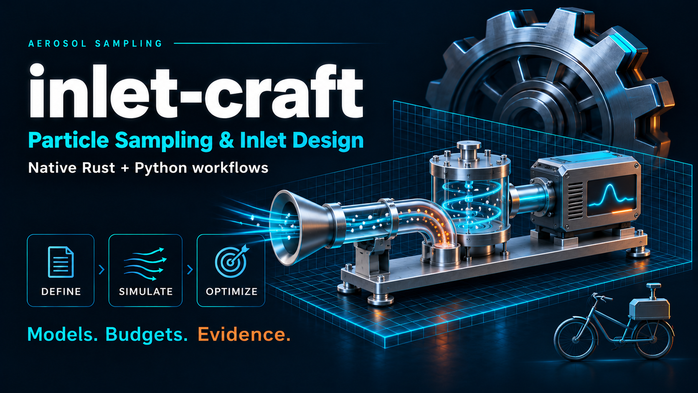

<p align="center">
  
</p>

# inlet-craft

Rust library and tools for an aerosol inlet, sampling line, mixing volume and sensor on a moving platform. It evaluates published correlations with SI inputs and explicit validity diagnostics, then searches designs with fcmaes DE or MODE.

**Status: provisional 0.1.0 source candidate.** Software verification is included; the stronger original-source/published-point gate G0 and independent comparison gate G1 remain incomplete. No on-bike validation, release tag or package publication is claimed. Start with [the guide](docs/guide/01-first-evaluation.md) and [the evidence ledger](docs/developer/formula-registry.md).

## First evaluation

Rust 1.88 or later and a Cargo registry connection on the first build. The two ecosystem crates are pinned source snapshots in `vendor/`, with upstream revisions and MIT licenses. Cargo registry dependencies are locked, not vendored.

```sh
cargo build --release --locked
target/release/inlet-craft check examples/bicycle.json > target/check.json
target/release/inlet-craft evaluate examples/bicycle.json > target/bicycle.json
target/release/inlet-craft verify > target/verification.json
```

The bicycle example has four riding speeds, two crosswinds and a declared bimodal number distribution. Aspiration can exceed one. Tube transport should be at most one inside its valid range; outside-range extrapolation is returned with diagnostics and is never clipped.

| Command | Result |
|---|---|
| `describe` | Actual schemas, implemented formula catalog, sources and limits |
| `check CASE` | Full validation, model coverage and warnings |
| `evaluate CASE` | Per-size, per-element/per-mechanism efficiencies, PM mass bias, time and distance |
| `sweep CASE` | Declared speed/wind Cartesian scenarios |
| `sweep CASE POINTER VALUES` | Numeric JSON-pointer sweep; failed rows retained |
| `optimize STUDY` | DE scalar search, MODE Pareto variant, budgets and cold checks |
| `verify [FIXTURES]` | Evidence-labeled numerical rows, nonzero exit if any row fails |

Read [case conventions](docs/guide/02-cases-and-warnings.md), [time/distributions](docs/guide/03-wind-pm-and-response.md), [design search](docs/guide/04-design-search.md), [Python/jobs](docs/guide/05-python-and-jobs.md), [comparison](docs/comparison.md), [architecture](docs/developer/architecture.md), and [validation protocol](docs/validation/protocol.md). Generated schemas live in `schemas/`; raw execution results live in `results/`.

## Verification

`cargo test --workspace --locked`, `cargo clippy --workspace --all-targets --locked -- -D warnings`, and `cargo fmt --all -- --check` test the Rust workspace. Build/install the native Python wheel with maturin, then run `python3 scripts/check_integration.py` and repeat with `python3 -O`. `scripts/check_oracles.py` compares installed aerosolpy, and `scripts/run_studies.py` reproduces the bounded study campaign. `scripts/check_docs.py` executes all shell/Python fences in authored documentation, checks JSON fences, and regenerates interface files/site. CI performs these checks. Optional AeroSampleR and IGOR checks remain distinct from measured physical validation.

MIT. Published mathematical equations are reimplemented with citations. No Particle Loss Calculator software code is included or was consulted.
